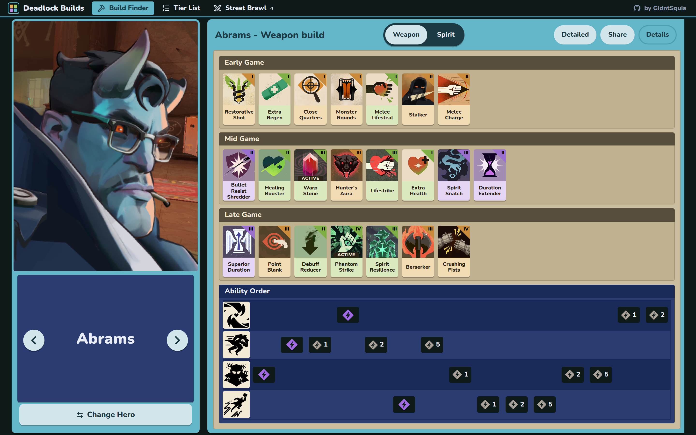
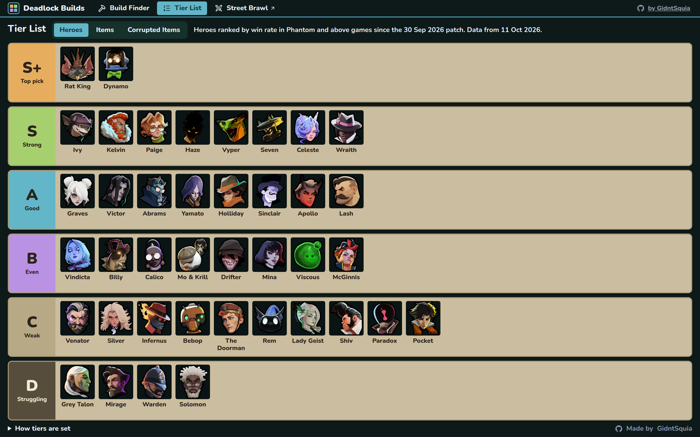

# Deadlock Optimal Build Finder 🔧

<p align="center">
  
</p>

Generates an item build for any [Deadlock](https://store.steampowered.com/app/1422450/Deadlock/)
hero: the items, the order to buy them in, and the ability level-up order. The
builds are based on the item and win rate stats for high-rank players from
[deadlock-api.com](https://deadlock-api.com). Each build is also compared to
the recent games of the top players on that hero so you can see how close it gets.

<p align="center">
  
</p>

There's also a tier list page that ranks heroes, items and corrupted items by
high-rank win rate. The Street Brawl link in the top bar goes to the companion project,
[deadlock-street-brawl-helper](https://github.com/Gidntsquia/deadlock-street-brawl-helper).

## Quickstart 🚀

Requires Node 18+.

```
git clone https://github.com/Gidntsquia/deadlock-optimal-build-finder
cd deadlock-optimal-build-finder
npm install
npm run fetch-data   # Downloads everything from the API into public/data/. Takes ~3 min, ~16 MB.
npm run dev          # Open http://localhost:5173
```

The app opens on a hero's build. Use the arrows or Change Hero to pick another
one. After the data is downloaded the app doesn't make any network requests.

Other commands:

```
npm run generate 1           # Print Infernus's build (any hero id works)
npm run verify               # Runs all the checks and prints the panel agreement per hero
npm test                     # The checks plus a browser run of the whole UI
```

## Features 🔬

- A build for each of the 40 heroes, using Phantom+ games since the latest patch.
  Heroes that don't have enough high-rank data use all ranks.
- Heroes with more than one established way to play (for example weapon and spirit
  Abrams) get one build per style, with a switch at the top of the build.
- Items are ordered by the average time players buy them at.
- The ability order is the sequence with the best win rate in high-rank games.
  Clicking an ability shows its stats and upgrades at any point in the build.
- Detailed view marks the items to sell later and the items worth corrupting.
- The Details button lists the numbers behind the build: games, win rates, buy
  rates and the score for each item.
- Each build is checked against a panel of up to 5 top players on that hero. The
  panel agreement is 76% median across heroes (80% for Infernus), and Details
  lists the core items the panel buys that the build is missing.
- Builds can be shared as an image.
- No backend, everything runs in the browser.

## Documentation 📚

More details in the
[wiki](https://github.com/Gidntsquia/deadlock-optimal-build-finder/wiki):

- [Data Pipeline](https://github.com/Gidntsquia/deadlock-optimal-build-finder/wiki/Data-Pipeline) — what `fetch-data` downloads, rank filtering, rate limits
- [How the Build Generator Works](https://github.com/Gidntsquia/deadlock-optimal-build-finder/wiki/How-the-Build-Generator-Works) — the scoring formula, buy order, ability order
- [Build Styles](https://github.com/Gidntsquia/deadlock-optimal-build-finder/wiki/Build-Styles) — when a hero gets more than one build
- [Held-out Validation](https://github.com/Gidntsquia/deadlock-optimal-build-finder/wiki/Held-out-Validation) — how the top player panel is chosen and scored
- [Judgment Calls](https://github.com/Gidntsquia/deadlock-optimal-build-finder/wiki/Judgment-Calls) — the weight changes and the reasoning behind them
- [Development](https://github.com/Gidntsquia/deadlock-optimal-build-finder/wiki/Development) — code layout, scripts, tests
- [Tier list rules](docs/tier-list.md) — how heroes and items are sorted into tiers

## License 📄

[MIT](LICENSE). Game data and images are downloaded from
[deadlock-api.com](https://deadlock-api.com) by `fetch-data` and aren't included
in the repo.
